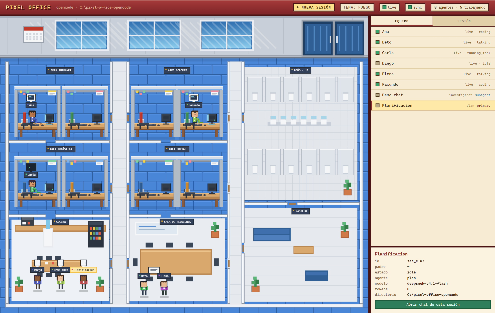

# Pixel Office for opencode

[](https://github.com/Jantilo-dev/Oficina_Opencode/actions/workflows/ci.yml)
[](LICENSE)



A tiny pixel-art office for **opencode**: it mirrors root sessions and their active
subagents in real time, and lets you create sessions and chat with them from the
browser. Local only, no telemetry.

The whole interface is in Spanish and every text file is stored as **UTF-8 without
BOM** (accents, tildes and `Ñ` included); `npm run check:encoding` validates it.

```
opencode (serve, 127.0.0.1:4096)
   |  SSE /global/event  +  REST /session, /session/status
   v
pixel-office API (127.0.0.1:5174)  ->  browser SPA (canvas)
```

## Requirements

- Node.js 20+ (tested on 24)
- opencode running as a server on a fixed port

## Run

```powershell
git clone https://github.com/Jantilo-dev/Oficina_Opencode.git
cd Oficina_Opencode
npm install

# terminal 1: opencode with a fixed port (or use `opencode serve --port 4096`)
opencode --port 4096

# terminal 2
npm run dev
```

Open <http://127.0.0.1:5180>.

If your opencode server is somewhere else, set `OPENCODE_URL` before starting the API:

```powershell
$env:OPENCODE_URL = "http://127.0.0.1:4096"
$env:PORT = "5174"
npm run dev
```

If your opencode server uses Basic auth, set `OPENCODE_SERVER_PASSWORD` (and
optionally `OPENCODE_SERVER_USERNAME`, default `opencode`); the proxy forwards it.

For a production build served by the API itself:

```powershell
npm run build
npm start
```

`npm start` serves `dist/web` from the API on `127.0.0.1:5174`.

## What you see

- A floor plan inspired by a classic cubicle office: carpet, white walls, an
  entrance and **reception** in the hall, four upper work areas, a conference room,
  kitchen, corridors, split **bathrooms** and **six lower offices**.
- The four upper work areas have **five desks each**: **PLANIFICACIÓN (JEFE)**,
  **FRONTEND**, **BACKEND**, **QA** and **DOCUMENTACIÓN**. The lower floor has
  **GERENCIA, OFICINA 2, OFICINA 3, OFICINA 4, OFICINA 5 and OFICINA 6**, each with
  two cubicles and a single door, for **32 seats total**. The manager (`plan` or
  `build`) takes one GERENCIA desk; select an eligible session in the team panel and
  press **HACER MANAGER** to change it. A fixed receptionist works at the hall
  entrance.
- Agents walk along the corridors and through the doors (pathfinding with the floor
  walls and furniture as obstacles); they no longer cross walls. Each upper area has
  internal aisles between desk rows and around the desks. The meeting room
  has a single entrance, and stairs at the bottom of the upper corridors and in the
  hall connect to the lower floor.
- Idle agents stay seated at their desks and occasionally get up for coffee, water or
  the bathroom. Bathrooms are split into **HOMBRES** and **MUJERES**, and agents use
  the side that matches their gender. Add `?breaks=fast` (or `?breaks=demo`) to
  preview that sooner; `?nobreaks` disables breaks.
- New sessions walk in from the entrance to their desk.
- The floor fills the screen (cover). Use the mouse wheel or the **+/−** buttons to
  zoom, drag to pan, **AJUSTAR** to see the whole floor and **LLENAR** to fill the
  screen again. The empty area is drawn as an "EN REPARACIÓN" construction zone.
- Activity from `message.part.updated`: `edit`/`write` types, `read`/`grep` reads, `bash` runs a terminal.
- Bubbles for permission requests (`!`), errors (`x`) and retries.
- While an agent is working, **SESIÓN** shows an animated activity line
  (**Pensando…**, **Revisando archivos…**, **Editando archivos…**,
  **Ejecutando comando…**) and the scene bubble/status updates immediately.
- When a worker goes from busy to idle, an alert appears with the person, cargo and
  group; click it to open that chat. Errors are shown as red alerts.
- Right panel with three tabs: **EQUIPO** (sessions, agent, status, details),
  **GRUPO** (custom group name, people and roles) and **SESIÓN** (chat with the selected
  session). The office draws only root sessions; active subagents and `live:` external
  agents remain in EQUIPO but do not take office desks or alter the five-person group.
- **INDEP: SÍ/NO** in the header shows or hides independent programmers (root sessions
  that are not part of a complete team). The choice is saved and also hides their desks
  and `live:` rows.
- If the last message asks a question, SESIÓN shows a **PENDIENTE** card. If it lists
  `OPCIONES: A) ... B) ...`, each option is a button; free text remains available.
  Replying clears the pending card. When a team uses OpenCode Go, its subagents inherit
  the Go model assigned to their parent role.
- In **GRUPO**, first see the list of complete groups; click a group to open its people
  and roles, and use **← GRUPOS** to go back. There you can name the work group and each
  person. The group name is shown on the office sign, and the person name is used on the
  nameplate and roster. Cargo comes from the role (Jefe, Frontend, Backend, QA,
  Documentación).
- In **EQUIPO**, select a session and choose its **puesto** (desk). **AUTO** lets the
  office pick one; assigned desks are saved in `localStorage`. **PAUSAS** in the
  header turns idle breaks on or off so characters can stay at their desks.
- For an upper area, assign one session to **PLANIFICACIÓN (JEFE)**, one to
  **FRONTEND**, one to **BACKEND**, one to **QA** and one to **DOCUMENTACIÓN**.
  Chat with the jefe and press **PASAR PLAN** in **SESIÓN**: the last assistant plan
  is sent to the other four sessions of that area. The jefe resolves the user’s
  questions and must finish each reply with **LISTO PARA PASAR AL EQUIPO: SÍ** or
  **LISTO PARA PASAR AL EQUIPO: NO**; the button stays disabled until the latest reply
  says **SÍ** and there is no pending question. When
  the four roles finish, the jefe posts **“El pedido ya está hecho, favor revisar para
  seguir con lo demás.”**. When the five roles are complete,
  the team is pinned to that office: seats are locked and its members do not leave for
  breaks or meetings. Teams are also detected by their session titles, so **PASAR PLAN**
  keeps working and the recommended seats are restored after a reload.
- Each role has a predefined brief: **Jefe** splits the plan; **Frontend** builds UI,
  buttons and styles; **Backend** builds logic, API and data; **QA** tests and
  acceptance; **Documentación** writes docs and Scrum. The brief is included in
  **PASAR PLAN** so each member knows its function.
- Subagents/external sessions are matched to a team through their `parentID` chain.
  They are automatically assigned **`opencode-go/deepseek-v4.1-flash`** so they do not
  fall back to the pay-as-you-go `opencode` provider.

## Create sessions and chat

- `+ NUEVA SESIÓN` opens a modal: pick an agent (primary or subagent), an optional
  model, a title and the first instruction.
- `CREAR EQUIPO` opens a modal: choose one of the four upper areas, plus the working
  method (**Plan** or **Build**) and the AI model for **Planificación (Jefe)**,
  **Frontend**, **Backend**, **QA** and **Documentación**. It creates the five
  sessions and assigns them to that area's role desks. Only the jefe starts; the
  other four wait for **PASAR PLAN**.
- Each agent card shows its `edit` and `bash` permissions, so you know what it may do.
- In the **EQUIPO** detail you can change a session's **método** and **modelo** at any
  time; the new values apply to later prompts and to **PASAR PLAN**.
- The session appears on the floor (it walks in) and opens in **SESIÓN**, with
  streaming text, tool chips, tokens/cost, an input to keep talking, **Abortar**
  while it works and **Eliminar** (also removes its subagents). The chat header keeps
  the title, `id`, `padre` and `estado` fixed while messages scroll; it changes only
  when you select another chat.
- Several sessions run in parallel, each with its own context and desk.

## Office editor

`EDITAR OFICINA` opens a puzzle-style layout editor:

- Pieces: areas of 5 desks, offices of 2, kitchen, meeting room, bathroom,
  reception, entrance, straight/corner/T/cross corridors, walls and doors. Rooms are
  drawn with floor, perimeter walls and a door opening; corridors are open floors.
- Pick a piece and click to place it; drag to move, `R` to rotate corridors/walls/doors
  or to cycle the door side of a room (right/bottom/left/top), `Supr` to delete, snap
  to a 20 px grid and magnetic alignment to other pieces.
- Pieces cannot overlap: the editor rejects occupied spaces.
- Navigate the canvas with drag on empty floor or right/middle mouse; zoom with the
  wheel; **Ajustar** fits the layout; **+ Ancho** / **+ Alto** expand the world.
- Save in `localStorage` and on the API (`layout.json`), export/import the layout as
  JSON. **Guardar** also confirms when the server copy is written. **Vaciar** starts
  empty and **Ejemplo** restores the sample layout.
- This editor is the layout designer. The live navigation and teams still use the
  current office until the layout is connected in the next phase.

## API endpoints

| Endpoint | Purpose |
|---|---|
| `GET /api/health` | app + upstream status |
| `GET /api/bootstrap` | directory, sessions, statuses, agent/model metadata |
| `GET /api/layout` | saved office layout (`layout.json`) |
| `PUT /api/layout` | persist the editor layout |
| `GET /api/events` | SSE proxy of opencode `/global/event` |
| `GET /api/opencode/agents` | opencode agents with mode and permissions |
| `GET /api/agents` | snapshot of external live agents |
| `GET /api/agents/stream` | SSE of external live agents |
| `GET /api/models` | provider/model list |
| `POST /api/sessions` | create a session |
| `POST /api/sessions/:id/prompt` | send an instruction (`agent`, `model?`, `text`) |
| `GET /api/sessions/:id/messages` | message history |
| `POST /api/sessions/:id/abort` | stop the current run |
| `DELETE /api/sessions/:id` | delete the session and its children |

## Themes

The header button cycles three palettes: **FUEGO**, **RUBÍ** and **ESMERALDA**.
The palette is applied to both the UI and the office (carpet, walls, panels and
corridors). The choice is saved in `localStorage`; `?theme=rubi` or
`?theme=esmeralda` in the URL picks one directly.

## Characters: names and avatars

In the **SESIÓN** tab press the pencil (✎) next to the title:

- **Nombre del personaje**: shown on the nameplate, the zone sign and the list.
- **Diseño personalizado**: all procedural characters use a **cat face** automatically.
  Fur style (short/long/twin/spiky), accessory (glasses/headband/cape/star), fur/shirt
  colours and muzzle tone are editable, with a live preview.
  The preview and the office use the same `characterSprite.ts` renderer. Seated
  characters look down toward the monitor and sit low behind the desk with a low-back
  chair; the desk hides their torso and their legs/shoes show under it. Hands rest on
  the keyboard and mouse, with typing and mouse movement animated. Their legs are drawn
  behind the desk so they stay below the tabletop.
- **Galería**: nine original archetypes (Original, Ninja, Idol, Científico, Héroe,
  Samurái, Maga, Piloto, Gótico). They are rendered as presets in the scene.
- **Imagen propia**: PNG/JPG/WEBP/GIF/SVG up to 256 KB. Image avatars can be data,
  blob or local paths; remote URLs are ignored by the scene. Uploaded images keep their
  own face instead of the generated cat face.
- Everything is stored in `localStorage` per session and removed when you delete it.

The project ships **no copyrighted characters** (no JJK, Pokémon, Miku, etc.). The
editor pieces are generic; if you upload your own images, use material you have the
rights to.

## Verify the event pipeline

```powershell
npm run probe
```

It creates a session with the `orquestador` agent, asks for two parallel `investigador`
subagents over `demo/`, and prints the events it observes.

## Security

- Binds to `127.0.0.1` only.
- It is a local control surface: it can create sessions and prompt agents, and
  agents act with their own permissions (edit files, run commands). Use read-only
  agents such as `investigador` for demos.
- No shell from the browser: the app only calls opencode with the chosen agent.
- No external assets, no CDN, no analytics.
- The opencode URL stays on the server; the browser only talks to this app.

## Clean the demo sessions

The probe creates sessions titled Oficina demo plus its subagents. To remove
them from this project (they are only demo data):

```powershell
npm run clean-demo          # lists them, deletes nothing
npm run clean-demo -- --yes  # deletes them
```

## Agent bridge (external reports)

Any local process or OpenCode hook can report its state to the dashboard.

`POST /api/agents/report`

```json
{
  "agentId": "ana",
  "name": "Ana",
  "status": "coding",
  "currentTask": "Refactor de autenticaci�n",
  "file": "src/auth.ts",
  "log": "editando auth.ts"
}
```

Statuses: `idle`, `thinking`, `coding`, `running_tool`, `talking`, `error`.

```powershell
curl.exe -X POST http://127.0.0.1:5174/api/agents/report `
  -H "Content-Type: application/json" `
  -d "{\"agentId\":\"ana\",\"name\":\"Ana\",\"status\":\"coding\",\"currentTask\":\"Refactor\",\"file\":\"src/auth.ts\",\"log\":\"editando auth.ts\"}"

curl.exe http://127.0.0.1:5174/api/agents
curl.exe -X DELETE http://127.0.0.1:5174/api/agents/ana
```

- `GET /api/agents` snapshot
- `GET /api/agents/stream` SSE (`snapshot`, `updated`, `removed`)
- `web/src/useAgentSync.ts` consumes the stream and batches updates per animation frame.
- OpenCode sessions are merged into the same scene automatically.
## Scene style

- 2.5D pixel art: dark-outlined sprites, no smoothing, extruded partitions,
  desks and chairs with front faces and shadows.
- Monitors and notebooks face the occupant (you see their backs and a glowing
  screen edge), not the camera.
- Status bubbles: `...` thinking, lit monitor coding, terminal running_tool,
  cup idle, speech talking, `!` error.
- Idle agents stay at their desks and take breaks at the café; `talking` agents
  meet in the meeting room.
## Areas

The floor is split into named rooms:

- AREA INTRANET, AREA LOGÍSTICA, AREA SOPORTE, AREA PORTAL (five desks each:
  Planificación/Jefe, Frontend, Backend, QA and Documentación)
- SALA DE REUNIONES (talking agents meet here; one entrance)
- COCINA (coffee, water, vending and table; agents come here on breaks)
- BAÑO split into HOMBRES and MUJERES (stalls, sinks and a dividing wall)
- PASILLO connecting the rooms, with reception and entrance door
- GERENCIA, OFICINA 2, OFICINA 3, OFICINA 4, OFICINA 5 and OFICINA 6 (two
  cubicles and one door each) on the lower floor, reached by the corridor and hall
  stairs

Desks keep their own monitor, keyboard, mouse and screen state. Seated agents rest
their hands on the keyboard and mouse; while coding they type and move the mouse.
A monitor turns on while its seat is occupied and turns off when the agent leaves;
off screens are dark with a red LED. Characters have a gender and use long hair
and/or a skirt when female. While an agent is working it stays at its assigned
desk; breaks and meetings are cancelled until it becomes idle again.

## Model region error

If opencode says a model is “hosted outside Europe and the United States”, set the
organization privacy region to **Global** in the opencode console (the app shows a
direct link in the error) or choose another model in **CREAR EQUIPO** / the session
detail. Models from the **OpenCode Go** provider are marked “requiere región Global”;
when the same model exists in the regional `opencode` provider, the error offers
**Usar modelo regional**, which switches the session model without resending the prompt.

## Model balance error

If opencode reports **Insufficient balance** or that a request is pay-as-you-go, the
model belongs to the billed **OpenCode** provider. Top up the credits from the link in
the error, or use an **OpenCode Go** model (OpenCode Go only covers requests to its own
provider). The model selector marks `opencode` as **pago por uso** and `opencode-go` as
**Go · región Global**. With a team selected, the error also offers **Usar OpenCode Go
en el equipo**, which switches each member to the Go equivalent of its model.

## License

GPL-3.0-only. Copyright (C) 2026 Julio Antilo. See [LICENSE](LICENSE).